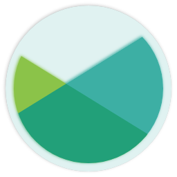
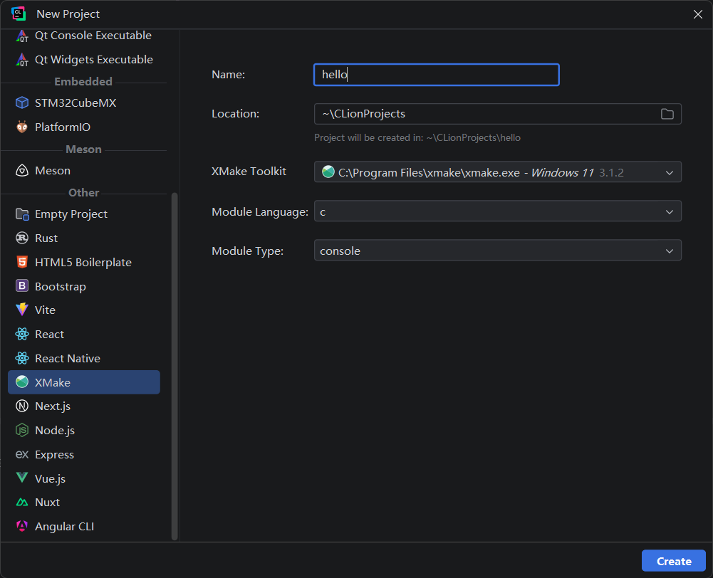
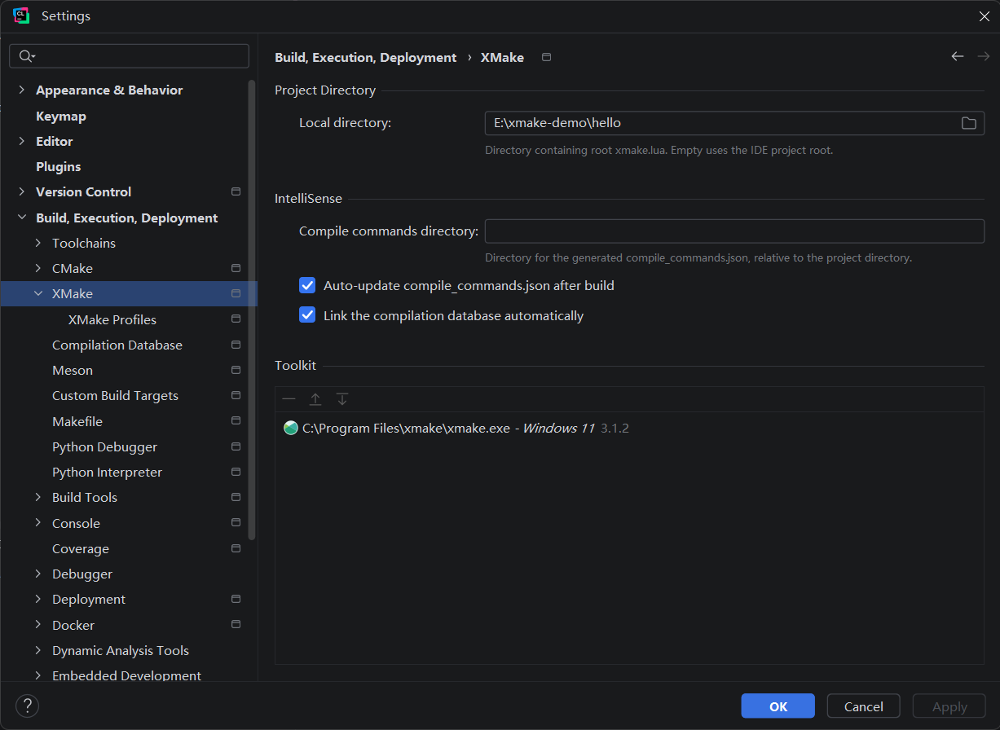
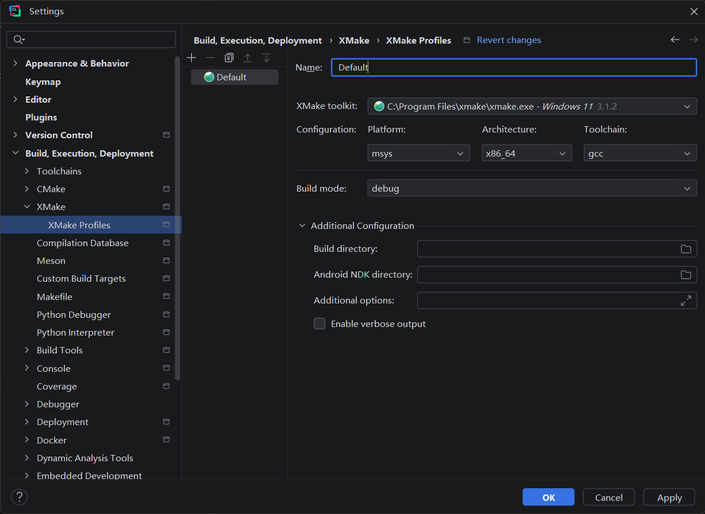
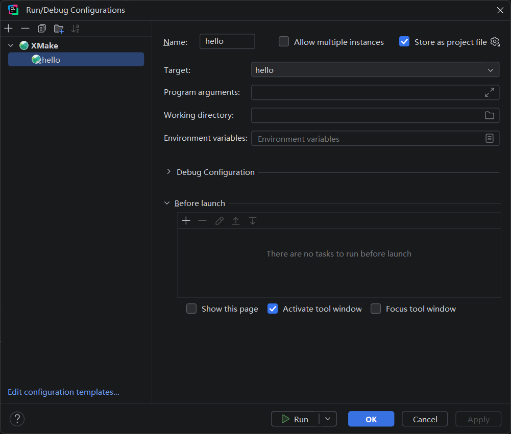
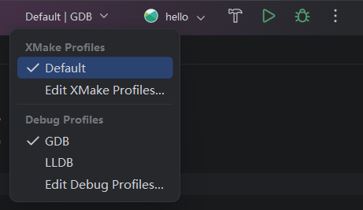
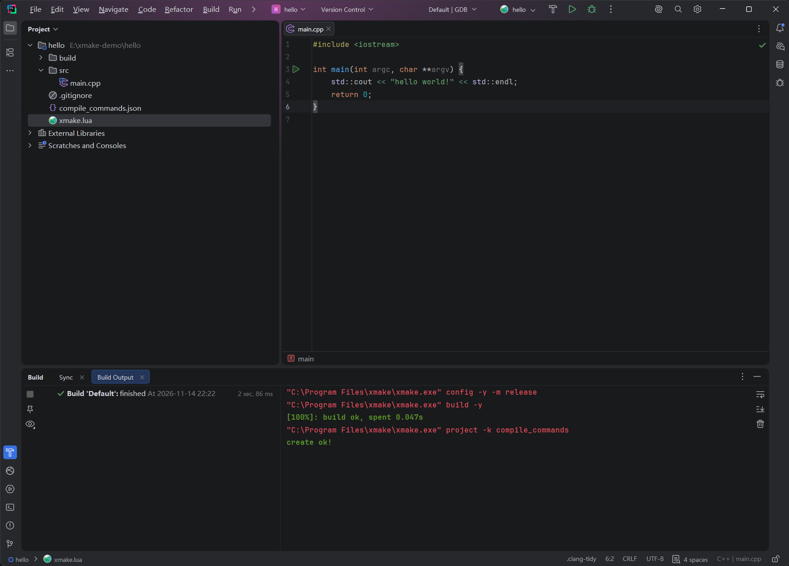
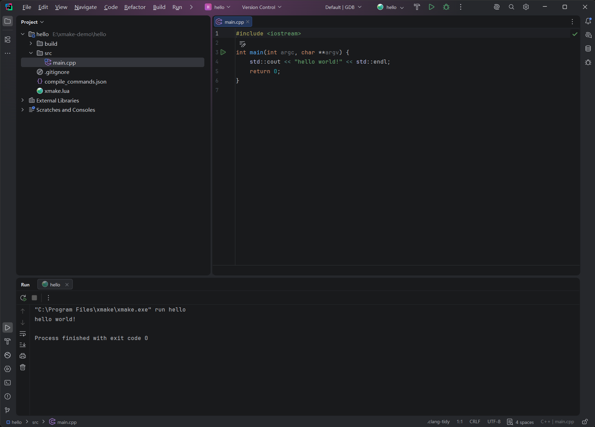
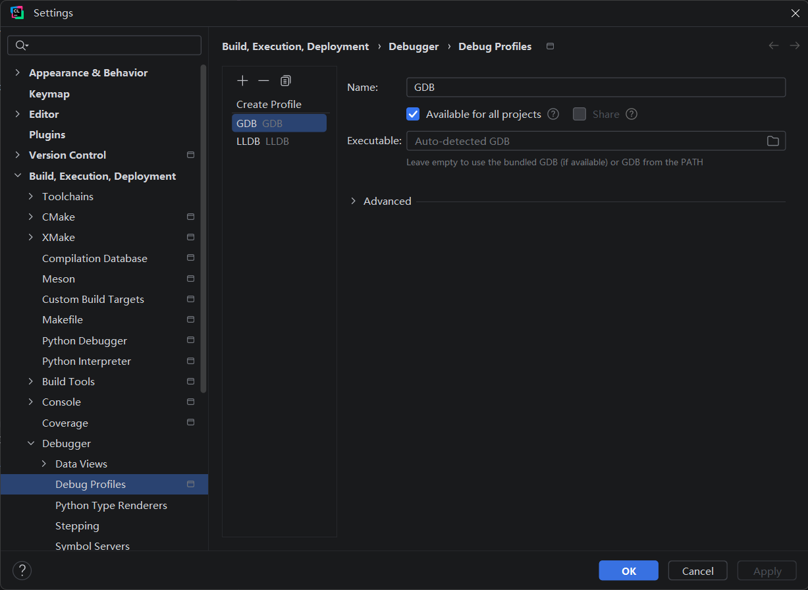

<div align="center">
  <a href="https://xmake.io">
    
  </a>

  <h1>xmake-idea</h1>

  <div>
    <a href="https://plugins.jetbrains.com/plugin/17406-xmake">
      
    </a>
    <a href="https://plugins.jetbrains.com/plugin/17406-xmake">
      
    </a>
  </div>
  <div>
    <a href="https://github.com/xmake-io/xmake-idea/blob/dev/LICENSE.md">
      
    </a>
    <a href="https://www.reddit.com/r/xmake/">
      
    </a>
    <a href="https://t.me/tbooxorg">
      
    </a>
    <a href="https://jq.qq.com/?_wv=1027&k=5hpwWFv">
      
    </a>
    <a href="https://discord.gg/xmake">
      
    </a>
    <a href="https://xmake.io/about/sponsor">
      
    </a>
  </div>

  <p>An XMake integration for IntelliJ IDEA and CLion</p>
</div>

## Introduction

An XMake integration for IntelliJ IDEA and CLion.

It is deeply integrated with [XMake](https://github.com/xmake-io/xmake) and IntelliJ IDEA to provide a convenient and fast cross-platform C/C++ development and build experience.

The plugin requires IntelliJ Platform **2026.2 or later**. **CLion** and **IntelliJ IDEA** are currently tested.

Install [XMake](https://github.com/xmake-io/xmake) on the machine or environment where you build the project. Add `xmake` to `PATH` for automatic detection.

Please see [XMake on GitHub](https://github.com/xmake-io/xmake) and the [website](https://xmake.io) to learn more about XMake.

## Features

* **Create and open XMake projects** — from the wizard, or any directory that contains `xmake.lua`
* **Build profiles** — each profile selects the toolkit, platform, architecture, toolchain, and build mode
* **Build, run, and clean targets** — from the `XMake` menu or the toolbar
* **Native debugging through CLion debug profiles** — or through an external DAP driver
* **C/C++ navigation in CLion** — powered by the generated `compile_commands.json`
* **Problems navigation** — compiler problems link back to the source location
* **XMake tool window** — the console for xmake builds and commands
* **Build profile switcher in the toolbar** — merged with CLion's debug profile switcher

## Installation

1. Install [XMake](https://xmake.io/#/guide/installation) on the machine or environment where you build the project. Add `xmake` to `PATH` for automatic detection.
2. Install [XMake from JetBrains Marketplace](https://plugins.jetbrains.com/plugin/17406-xmake) in CLion or IntelliJ IDEA.
3. Open or create a project, then select an XMake installation in the active build profile.

## Getting Started

### Open an Existing Project

Open the project directory in the IDE. The directory must contain an `xmake.lua` file.

Select the XMake installation in the active build profile. The `XMake toolkit` list contains the available installations.

### Create a New Project

Use `File > New > Project`, choose `XMake`, then configure the project location, XMake installation, module language, and module type.

<p align="center">
  
</p>

<p align="center"><em>XMake project wizard in CLion.</em></p>

## Project Settings

Open `Settings > Build, Execution, Deployment > XMake`. The page contains three sections:

| Section | What it configures |
| --- | --- |
| `Project Directory` | The directory that contains the root `xmake.lua` file |
| `IntelliSense` | The `compile_commands.json` output directory, automatic update after build, and automatic compilation database linking |
| `Toolkit` | The registered XMake installations — local, WSL, or SSH |

<p align="center">
  
</p>

<p align="center"><em>XMake settings in CLion.</em></p>

### Build Profiles

Open `Settings > Build, Execution, Deployment > XMake > XMake Profiles`. A build profile selects the XMake toolkit, platform, architecture, toolchain, and build mode. The additional configuration provides the build directory, Android NDK directory, extra configure options, and verbose output.

<p align="center">
  
</p>

<p align="center"><em>XMake build profile in CLion.</em></p>

For SSH toolkits, the profile also provides `Upload` and `Download` actions for the project files.

## Run Configurations

Create an XMake run configuration in `Run > Edit Configurations`. Select a target, then configure the program arguments, working directory, and environment variables. The configuration runs with the active build profile.

<p align="center">
  
</p>

<p align="center"><em>XMake run configuration in CLion.</em></p>

The toolbar next to the run configurations selects the active XMake build profile and, in CLion, the debug profile. The selected XMake build profile is used for build, run, and debug.

<p align="center">
  
</p>

<p align="center"><em>XMake build profile and debug profile switcher in the toolbar.</em></p>

## Build and Run

Use the `XMake` menu or the toolbar to run, debug, build, rebuild, clean, and update generated files.

`Build Project` runs configure and build. Build output appears in the `Build` tool window. Compiler problems are reported in the `Problems` tool window. Select a problem to open the corresponding source location.

<p align="center">
  
</p>

<p align="center"><em>Build output for the hello target.</em></p>

`Run Target` runs the selected target. Its output appears in the `Run` tool window.

<p align="center">
  
</p>

<p align="center"><em>Run output for the hello target.</em></p>

## C/C++ Navigation

C/C++ navigation requires CLion. The plugin generates `compile_commands.json` for C/C++ code navigation. Configure the output directory and automatic update in `Settings > Build, Execution, Deployment > XMake > IntelliSense`. The plugin can link the compilation database automatically. If automatic linking is disabled, open the generated `compile_commands.json` via `File > Open` and let CLion import it. To generate it manually, select `XMake > Update Compile Commands`.

## Debug

### Native Debugging

Native debugging requires CLion. `Debug Target` launches through CLion's own debugger. It follows the active debug profile selected in CLion and falls back to the bundled LLDB when no profile is available. The toolbar switcher next to the run configurations combines the selected configuration's XMake build profiles with CLion's debug profiles.

CLion manages the debug profiles in `Settings > Build, Execution, Deployment > Debugger > Debug Profiles`.

<p align="center">
  
</p>

<p align="center"><em>CLion Debug Profiles settings.</em></p>

<p align="center"><small>The Debug Profiles page is provided by CLion; it is not a panel designed by the plugin.</small></p>

Optionally, use an external Debug Adapter Protocol (DAP) driver. In the plugin's run configuration, expand `Debug Configuration` and enable `Use an external DAP driver instead of CLion's active debug profile`. Then install a supported DAP driver:

* **LLDB DAP:** `lldb-dap` (recommended)
* **GDB DAP:** a `gdb` executable with DAP support

Leave `Auto-detect DAP driver` enabled to let the plugin find the driver, or select the driver path manually.

### Legacy Debugging (CMake)

Legacy debugging requires CLion.

1. Select `XMake > Update CMakeLists` to create or update the `CMakeLists.txt` file.
2. Click `File > Open...` to choose this file.
3. Choose `Run > Debug...` or `Run > Debug 'project name'` to start debugging.

## How to contribute?

Due to limited personal time, I cannot maintain this plug-in all the time. If you encounter problems, you are welcome to download the plugin source code, debug it yourself, and open a pull request to contribute.

### Build this project

This project requires a JDK 25 toolchain. Use the included Gradle wrapper to build it.

```powershell
.\gradlew.bat build
```

On Linux or macOS, run `./gradlew build` instead.

### Run and debug this project

Run `.\gradlew.bat runIde --stacktrace` on Windows or `./gradlew runIde --stacktrace` on Linux and macOS.

For more details, please visit: [`CONTRIBUTING.md`](https://github.com/xmake-io/xmake-idea/blob/dev/CONTRIBUTING.md)

## Powered by

[](https://jb.gg/OpenSource)
